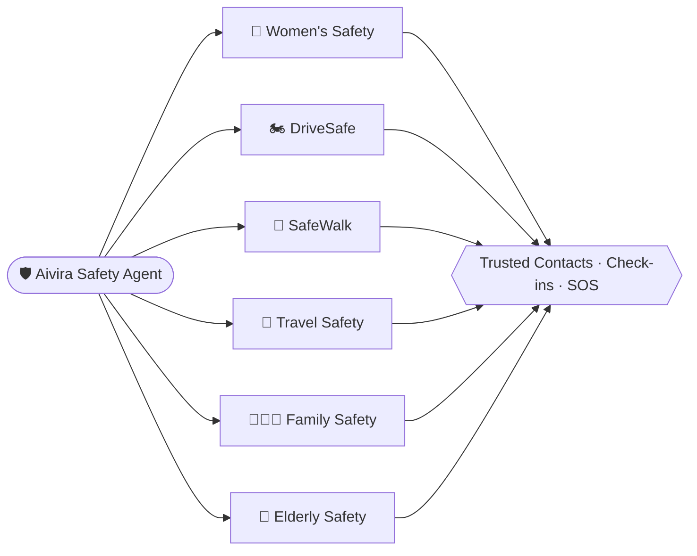
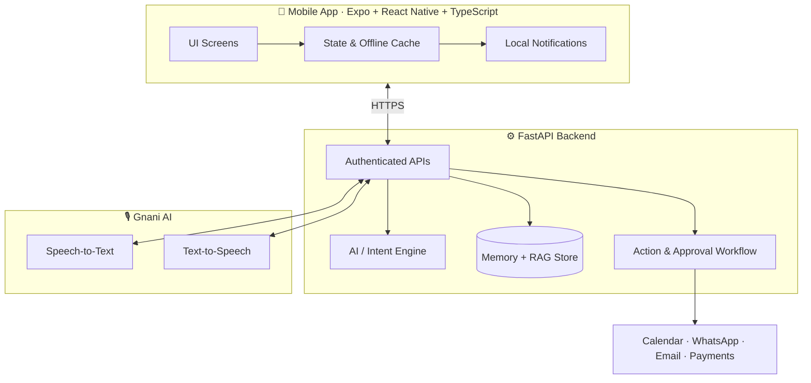

<div align="center">


<br/>

<a href="https://git.io/typing-svg">
  
</a>

<br/><br/>


**[Features](#-features) · [App UI](#-app-ui-gallery) · [Safety Agent](#-aivira-safety-agent) · [Architecture](#-architecture) · [Getting Started](#-getting-started) · [Roadmap](#-roadmap)**


</div>

## ✨ What is Aivira?

**Aivira** is a universal AI personal assistant for **every stage of life** — from a school child to a startup founder or company owner. It understands real-life situations, remembers commitments, organises responsibilities and helps people take the right action.

> Voice assistants take commands. **Aivira understands what matters, remembers your commitments and helps you never forget the important things.**

```text
You   : "Rohan ki school fees 15 December ko due hai. Mujhe 5 din pehle remind karna."
Aivira: ✅ Reminder set for 10 December + another on the due date.
```

### 🌟 Three Signature Features

| 🧠 Situation Intelligence | 🤝 Promise Tracker | 🚨 Smart Escalation |
|---|---|---|
| Understands context and *suggests* actions — always asks permission first. | Remembers things like *"I'll send you the file tomorrow"* and reminds you before they're due. | Important task still pending? Re-reminds or notifies an authorised person per **your** rules. |


## 📱 App UI Gallery

> Full design collage — 15 screens across onboarding, modules, planner, safety, memory and settings.

<div align="center">
  
</div>

### 🚀 Onboarding → Home


*Splash · Onboarding · Login/Signup · Home Dashboard · Modules*

### 🧩 Life Management Screens


*FamilyLife Manager · Safety Agent (Women Safety) · DriveSafe · Smart Planner · Tasks*

### 🎙️ Voice, Memory, Settings & Safety


*Voice Assistant · Memory & Notes · Settings · SOS Alert (dark) · Daily Briefing*


## 🧰 Features

Aivira is organised into **20 modules** grouped into 7 sections — not 100 features dumped on one screen.

| Section | Modules |
|---|---|
| 🏠 **Personal Life** | FamilyLife · MoneyMate · HomeMate · TravelMate |
| 📞 **Communication** | Calling Assistant · DriveSafe · ConnectAI |
| ✅ **Productivity** | WorkMate · Planner · Tasks · PromiseOS |
| 🛡️ **Health & Safety** | CareMate · Aivira Safety Agent |
| 💼 **Business** | FounderOS · Employee Management · Business Intelligence |
| 🧠 **AI Intelligence** | LifeOS · MemoryOS · DocuMind AI · Situation Intelligence |
| ⚙️ **Automation** | ActionOS · Smart Reminders · Smart Escalation |

<details open>
<summary><b>🎙️ 1. AI Voice Assistant</b></summary>

- Multilingual voice — **Hindi, English, Hinglish**
- Real-time interaction with live waveform, speech recognition and natural responses
- Multi-instruction understanding from a single sentence
- Text-based interaction when voice is inconvenient
- Continuous conversation with interruption support
- Automatic language detection
</details>

<details>
<summary><b>📞 2. AI Calling Assistant</b></summary>

- WhatsApp calling (personal + group), normal phone calling, **Aivira-to-Aivira internet calls**
- Schedule calls & recurring calls, send call invitations
- Personal call reminders, missed-call follow-up
- Call history, smart contact selection, incoming/outgoing call screens
- Call controls: mute, speaker, accept, reject, end
</details>

<details>
<summary><b>👨‍👩‍👧 3. Family & Child Management — FamilyLife</b></summary>

- School fee reminders, homework tracker, exam & result alerts
- School events (PTM, holidays, functions), transport alerts
- Parent-child task sharing (age-appropriate), family calendar
- Document expiry alerts, child activity updates, family follow-ups
</details>

<details>
<summary><b>🚗 4. Driving & Urgent Call Assistant — DriveSafe</b></summary>

- Automatic hands-free **Driving Mode** (with permission)
- Urgent call announcements, hands-free answer/reject
- Priority contacts, approved **driving auto-reply**
- Voice notification & delivery-instruction reading
- Missed-call callback reminders, emergency contact access
- Bluetooth & headset integration
</details>

<details>
<summary><b>💰 5. Money & Payments — MoneyMate</b></summary>

- School/college fees, electricity & utility bills, rent, EMI & loans
- Subscription renewals, employee salary reminders, customer dues
- Invoice & bill management, payment confirmation, expense tracking
</details>

<details>
<summary><b>🧑‍💼 6. Work & Employee Assistant — WorkMate AI</b></summary>

- Attendance reminders, shift management, voice **task delegation**
- Work deadline alerts, meeting coordination, leave management
- Payroll reminders, employee follow-ups, daily work summary, onboarding tracker
</details>

<details>
<summary><b>🆘 7. Personal Safety — SafeCircle</b> <i>(now part of Safety Agent)</i></summary>

- SOS alert, live location sharing (consent-based), emergency calling
- Safe-arrival & travel check-ins, missed check-in alerts
- Emergency information & recurring safety routines
</details>

<details>
<summary><b>🩺 8. Health & Elderly Care — CareMate</b></summary>

- Medicine reminders & confirmation tracking, caregiver notifications
- Doctor appointments, health routines, check-up schedule
- Prescription refill alerts, health document management
</details>

<details>
<summary><b>📦 9. Shopping & Delivery — TrackMate</b></summary>

- Order tracking, delivery alerts, delivery-call handling via DriveSafe
- Voice shopping lists, grocery reminders
- Return deadlines, warranty reminders, service appointments
</details>

<details>
<summary><b>🚀 10. Startup & Business Owner — FounderOS</b></summary>

- Investor follow-ups, client management, meeting preparation
- Business decision memory, team coordination, contract deadlines
- Vendor follow-ups, expense reminders, daily founder briefing
- Opportunity tracker, pitch preparation, business goal tracking
</details>

<details>
<summary><b>💬 11. Communication & Relationships — ConnectAI</b></summary>

- Important call reminders, birthday & anniversary alerts
- Missed-call follow-up, scheduled calls, WhatsApp assistance
- Meeting invitations, relationship notes, follow-up tracking, contact groups
</details>

<details>
<summary><b>✈️ 12. Travel — TravelMate</b></summary>

- Journey reminders, flight & train alerts, packing checklist
- Hotel booking reminders, passport/ID expiry alerts
- Route preparation, family travel updates, travel driving mode
</details>

<details>
<summary><b>🏡 13. Home & Household — HomeMate</b></summary>

- Chores, water & electricity alerts, appliance maintenance
- Gas cylinder reminders, domestic help schedule
- Family shopping lists, shared tasks, home expense tracking
</details>

<details>
<summary><b>📰 14. Daily Briefing — LifeOS Intelligence</b></summary>

- Morning briefing & evening summary
- Priority detection, **conflict detection**, missed-responsibility alerts
- Contextual suggestions, natural-language memory, personalised recommendations
- Daily activity insights, schedule optimisation
</details>

<details>
<summary><b>🤝 15. Commitments & Follow-ups — PromiseOS</b></summary>

- Promise tracker, **Waiting-For** tracker, smart follow-up
- **Smart Escalation**, adaptive reminders
- Commitment completion, history and shared-responsibility tracking
</details>

<details>
<summary><b>📄 16. Documents — DocuMind AI</b></summary>

- Reads bills, notices, school circulars and invoices
- Automatic deadline extraction, receipt recognition
- Natural-language document search, smart organisation, summaries, expiry notifications
</details>

<details>
<summary><b>🧠 17. Memory & Voice Notes — MemoryOS</b></summary>

- Voice notes, audio transcription, AI summarisation
- **Long-term memory with RAG**, "Ask your memory"
- Automatic task extraction, smart note categories
- **Source-based answers** (shows which note supports a reply)
- Memory controls — review, disable or delete
</details>

<details>
<summary><b>⚡ 18. Automation & Human Approval — ActionOS</b></summary>

- Smart action detection, AI email assistance
- **Human approval system** — approve / edit / reject before execution
- Calendar & communication automation
- Payment assistance (explicit confirmation always required)
- Action history, undo & recovery, permission-based automation
</details>

<details>
<summary><b>🎨 19. Personalisation & Settings</b></summary>

- Personas: School Student · College Student · Professional · Founder · Company Owner · Household
- Language, voice & playback speed, notification preferences
- Privacy & security, data export/deletion, light & dark themes
- Family & organisation workspaces with role-based access
- Connected accounts
</details>

<details>
<summary><b>🛠️ 20. Technical & Platform Capabilities</b></summary>

- Android-first app (Expo · React Native · TypeScript)
- Offline support — cached tasks/notes, queued text requests
- Local + push notifications, background sync
- FastAPI backend with authenticated APIs
- Gnani speech-to-text & text-to-speech via backend
- Secure tokens, approval workflows, accessibility support
</details>


## 🧠 Situation Intelligence in Action

Aivira doesn't wait for exact commands — it understands context and **asks before acting**.

| Situation | Aivira says |
|---|---|
| 🎒 School fee due in 5 days | *"Rohan's school fee of ₹8,000 is due on 15 December. Remind you on 12 December?"* |
| 🏍️ Rider gets an important call | *"Your delivery manager is calling. Answer using your headset or call back when safe."* |
| 🚀 Investor follow-up due | *"You planned to send the pitch deck today. Prepare an email draft?"* |
| 💊 Medicine reminder unconfirmed | *"Papa's 9 PM medicine reminder hasn't been confirmed. Send a check-in?"* |

## 🛡️ Aivira Safety Agent

One safety engine, many modes — it merges the original **DriveSafe** and **SafeCircle** ideas.



**Women's Safety tools:** live location sharing · safe journey timer · SOS · route-deviation check · emergency calling · missed check-in alerts · voice-activated SOS · hands-free mode · trusted circle · discreet shortcut.

**Safety principles**
- 📍 **Consent-based location** — you choose who sees it, and for how long.
- ⚠️ **No false certainty** — a route deviation or missed check-in is a *signal to check*, not proof of danger.
- ⚙️ **Configurable escalation** — you set contacts, timing and retries.
- 🚫 **No guaranteed rescue** — emergency-service availability depends on device, network and region.
- 🏍️ **Hands-free first** — never encourages phone use while riding or driving.


## 🏗️ Architecture



**Workspace model:** Personal + Family + Organisation workspaces, each with its own members, permissions and data. Business data stays separate from personal and family data. Child accounts have parental supervision.

## 🧪 Tech Stack

| Layer | Technology |
|---|---|
| Mobile | Expo, React Native, TypeScript |
| Backend | Python, FastAPI |
| Voice | Gnani AI (STT + TTS) |
| Memory | Structured storage + RAG retrieval |
| Notifications | Local scheduled + push |
| Auth | Secure tokens, role-based access |

## 🚀 Getting Started

```bash
# 1. Clone
git clone https://github.com/<your-username>/aivira.git
cd aivira

# 2. Backend
cd backend
python -m venv .venv && source .venv/bin/activate   # Windows: .venv\Scripts\activate
pip install -r requirements.txt
cp .env.example .env        # add your keys
uvicorn app.main:app --reload

# 3. Mobile app
cd ../mobile
npm install
npx expo start
```

**Environment variables** (`backend/.env`)

```env
GNANI_API_KEY=your_key_here
DATABASE_URL=your_database_url
SECRET_KEY=your_secret
```

> Update the folder names, commands and variables above to match your actual repository.

## 📂 Project Structure

```text
aivira/
├── mobile/            # Expo + React Native app
│   ├── app/           # Screens & navigation
│   ├── components/    # Reusable UI
│   └── services/      # API, notifications, offline queue
├── backend/           # FastAPI server
│   ├── app/           # Routes, models, AI logic
│   └── requirements.txt
├── assets/            # README images
└── README.md
```

## 🗺️ Roadmap

- [x] **Phase 1 – Core Assistant:** voice, memory, tasks, calendar, reminders, multilingual, daily briefing
- [ ] **Phase 2 – Real-life Assistance:** family management, school fees, DriveSafe, smart calling, bill reminders
- [ ] **Phase 3 – Professional & Business:** employee management, FounderOS, client follow-ups, delegation
- [ ] **Phase 4 – Advanced Intelligence:** Situation Intelligence, document understanding, promise tracking, advanced automation

> Tick the boxes to match your real progress.

## 🔐 Privacy, Safety & Honest Notes

- Automated actions are **permission-based**, with extra safeguards for **children, money, health data and driving**.
- Payments always need **explicit user confirmation**.
- Memory is user-controlled — review, disable or delete anytime.
- This is a **proposed feature catalogue**, not a claim that every feature is implemented. WhatsApp, native calling, VoIP, payments, background services and automatic driving detection each need separate platform integrations and permissions.

## 🤝 Contributing

Contributions, ideas and feedback are welcome!

1. Fork the repo
2. Create a branch: `git checkout -b feature/amazing-feature`
3. Commit: `git commit -m "Add amazing feature"`
4. Push and open a Pull Request

## 🙏 Credits

- Voice AI powered by **[Gnani AI](https://www.gnani.ai/)**
- Built with Expo, React Native and FastAPI

<div align="center">


### **Aivira — Your Life. Your Work. One AI.**


</div>
